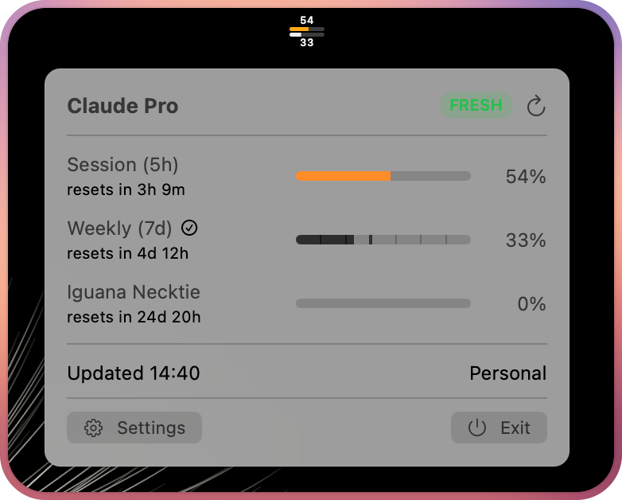
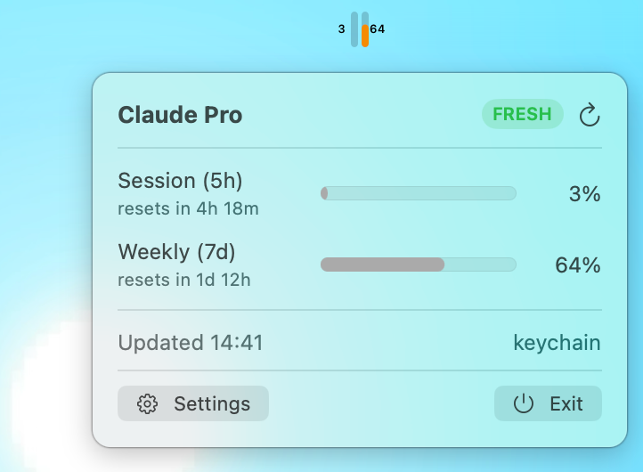
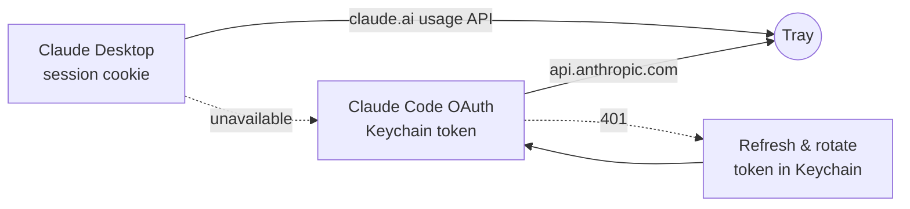

<h1 align="center">Claude Tray Monitor</h1>

<p align="center">
  <b>Your Claude plan limits, always one glance away in the macOS menu bar.</b><br>
  Native AppKit · no Electron · zero configuration · ~40 MB RAM
</p>

<p align="center">
  <a href="https://github.com/yumedzi/claude-tray-monitor/releases/latest"></a>
  
  
  <a href="LICENSE"></a>
</p>

<p align="center">
  
</p>

Two slim bars in the menu bar show your **5-hour session** and **7-day weekly**
usage. Click them for the full picture: every quota window, reset countdowns,
pace markers, and monthly spend — refreshed on a gentle, configurable schedule.

---

## ✨ Highlights

| | |
|---|---|
| 🪶 **Tiny tray footprint** | Vertical (`54 ‖ 33`) or horizontal stacked bars; the item shrinks to just the bars when labels are off. |
| 📊 **Rich popover** | All quota windows with reset countdowns, plan label, FRESH/STALE badge, and one-click reload. |
| 🐇 **Pace markers** | Weekly bar shows a tick per day (today highlighted) so you see at a glance whether you're ahead of or behind an even pace; spend bars mark the ideal amount for this point in the month. |
| 💳 **Enterprise spend** | For Enterprise orgs the tray switches to monthly spend — used over limit (`$247` / `$1k`). |
| 👥 **Multiple accounts** | Switch between Claude Desktop profiles and organizations from the right-click menu; rename or hide them in Settings. |
| 🎨 **Fits your menu bar** | Follows macOS light/dark automatically; green / orange / red thresholds you can tune. |
| ⚡ **Zero config** | Picks up your logged-in Claude Desktop session, falls back to Claude Code's Keychain login. |

## 📸 Screenshots

<table>
  <tr>
    <td align="center"><br><sub>Horizontal bars · pace ticks · monthly spend</sub></td>
    <td align="center"><br><sub>Vertical bars · compact tray</sub></td>
  </tr>
</table>

## 📦 Install

1. Download `ClaudeTrayMonitor-macos.dmg` from
   [**Releases**](https://github.com/yumedzi/claude-tray-monitor/releases/latest).
2. Open it and drag **Claude Tray Monitor.app** into Applications.
3. First launch: right-click the app → **Open** (or run the command below).

```bash
xattr -dr com.apple.quarantine "/Applications/Claude Tray Monitor.app"
```

> [!NOTE]
> **Why the Gatekeeper warning?** The app is free, ad-hoc signed and not
> notarized — notarization requires the paid Apple Developer Program. You only
> confirm it once.

**Requirements:** macOS 14 (Sonoma) or later and a logged-in Claude app —
Claude Desktop is auto-detected; Claude Code CLI / VS Code logins are used as a
fallback.

To uninstall, just delete the app.

## 🧭 Using it

- **Left-click** the bars → popover with all quota windows, last update time
  and credential source, plus **Settings** and **Exit**.
- **Right-click** → Check Now, Account, Launch Desktop, Settings, Quit.
- **Hover** a popup bar → tooltip explaining the pace icon and the ideal
  usage for right now.

### Settings at a glance

- Bar orientation (vertical / horizontal), percentages and `s`/`w` labels on/off
- Which quota window feeds each bar — session, weekly, weekly Sonnet / Opus /
  Fable, or any new window Anthropic adds
- Polling interval **1–60 min** (one request per interval, built-in 429
  throttling) and an auto-refresh toggle
- Warning / error color thresholds, theme override (auto / light / dark)
- Account selection, renaming and hiding; extra Claude Desktop profile folders
- Launch at Login

## 🔍 How it works



1. **Claude Desktop session** (default) — decrypts the `sessionKey` cookie from
   the desktop app's local Chromium profile (key: `Claude Safe Storage` in your
   login Keychain) and queries `claude.ai/api/organizations/…/usage`, the same
   endpoint the web UI uses. No OAuth tokens, separate rate-limit bucket.
2. **Claude Code OAuth** (fallback) — polls `api.anthropic.com/api/oauth/usage`
   with your Keychain credentials, refreshing expired tokens against
   `platform.claude.com` and writing the rotated pair back.

If a credential is rejected (e.g. after an account switch) the app moves to the
next stored login automatically — unless you pinned a specific account.

## 🔒 Security & privacy

- **Only talks to Anthropic** — `claude.ai` and `api.anthropic.com`, nothing else.
- **Credentials stay local** — tokens and cookies are decrypted in memory and
  used only in request headers; never logged, stored, or shown in the UI.
- **One-time Keychain prompt** — macOS asks to let the app read
  `Claude Safe Storage`; choose *Always Allow*. Until then it silently uses the
  OAuth route.
- **No files with secrets** — settings live in `UserDefaults`; Launch at Login
  uses `SMAppService`.
- **Small, readable source** — no obfuscation, no third-party dependencies.

## 🛠 Build from source

```bash
make bundle    # release build + build/Claude Tray Monitor.app
make install   # copy to ~/Applications and relaunch
make run       # run in place with swift run
make dmg       # build/ClaudeTrayMonitor-macos.dmg
make publish   # DMG + zip → GitHub Release (needs gh)
```

Logs: `~/Library/Logs/ClaudeTrayMonitor/requests.log`.

## 🙏 Credits

Inspired by [_usage-monitor-for-claude_](https://github.com/jens-duttke/usage-monitor-for-claude)
(Windows) and the API/credential logic of the author's VS Code extension
_claude-context-monitor_.

## License

[MIT](LICENSE). Independent, community-built project — not created, endorsed,
or officially supported by Anthropic. "Claude" and "Anthropic" are trademarks
of Anthropic, PBC, used here solely to indicate compatibility.
